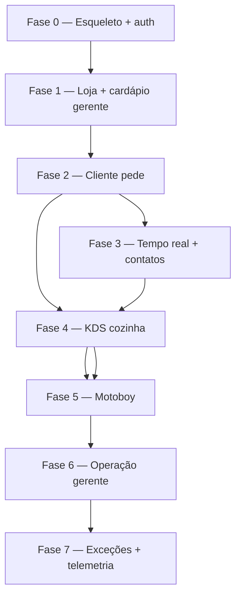

# IMP-01 — Ordem de implementação para IA (MVP VEGGO Delivery)

Documento **solo** para agentes de código: sequência que respeita dependências de **domínio, banco, API e telas**, evitando estados inventados no front ou endpoints duplicados.

**Fonte da verdade de produto:** [`pitch_delivery.md`](pitch_delivery.md)  
**Regras técnicas:** [`docTecnica/README.md`](docTecnica/README.md)  
**Fluxos:** [`fluxos/README.md`](fluxos/README.md)

---

## 1. A ordem que você sugeriu — o que acerta e o que falta

Ordem proposta (por persona):

```text
Cliente: HAPPY-22 → 03 → 21 (+ 01, 02, 02-recuperacao, 04)
         ↓ checkout
Cozinha: HAPPY-11 + ORD-01 §5 + INF-04 §1 + INF-02 accept/ready
Motoboy: HAPPY-20 + INF-04 §2 + INF-02 /take, /deliver
Dados:   DB-02 + DB-04 + ORD-01
Erros:   SAD-03, 06, 24, 25 (+ demais sad)
```

| Aspecto | Avaliação |
|---------|-----------|
| Cliente antes de cozinha/motoboy | ✅ Correto para fatia vertical “pedido nasce no app” |
| `01, 02, 04` junto do checkout | ✅ Certo — sem auth e endereço o checkout quebra |
| Cozinha depois do checkout | ✅ Pedido `RECEBIDO` só existe após `POST /orders` |
| Motoboy por último entre operadores | ✅ Depende de `PRONTO` |
| `DB-02 + DB-04 + ORD-01` listados à parte | ⚠️ **Devem entrar antes** do HAPPY-21, não depois — senão checkout e KDS divergem |
| Sad só no final | ⚠️ Integrar **por fase** (checkout sad com checkout, fila sad com KDS) |
| WebSocket / timeline | ❌ Ausente na lista — **INF-01 + HAPPY-06** entre checkout e cozinha (cliente) ou em paralelo ao KDS |
| Backoffice mínimo (loja, cardápio seed) | ❌ Ausente — cliente não pede sem produtos, `store_status` e taxa de entrega configurada |
| `HAPPY-13` funcionários | ❌ Ausente — cozinha/motoboy precisam de login antes do KDS/app motoboy |

**Conclusão:** a ordem por persona é boa como **história de uso**, mas a IA deve seguir **camadas + marcos** abaixo, não só a lista “Cliente → Cozinha → Motoboy”.

---

## 2. Ordem recomendada (8 fases)

Regra de ouro: **backend de domínio e migrações à frente de qualquer tela**; **uma transição de estado = uma implementação** (ORD-01 + INF-02); **FGAC e Problem Details** desde a fase 2.



---

### Fase 0 — Esqueleto, auth, schema mínimo

**Objetivo:** subir monólito + gateway + Postgres + Redis; login funcional; nenhuma tela de negócio ainda.

| Camada | Entregar |
|--------|----------|
| Docs | `pitch_delivery.md` § arquitetura · **INF-03** · visão **ORD-01** §1 estados (enum) |
| DB (Flyway) | `users`, `stores` (`whatsapp_number`, `timezone`, `store_status`), roles; **sem** pedido ainda ou tabela `orders` vazia |
| Backend | Módulos vazios; `SecurityConfig` Argon2id; JWT web/mobile; Problem Details base |
| Seed | 1 loja, 1 `GERENTE_LOJA` demo |

**Não fazer ainda:** KDS, motoboy, checkout, WebSocket.

---

### Fase 1 — Loja aberta, cardápio (gerente)

**Objetivo:** API de produtos/categorias e loja configurada para o cliente conseguir pedir depois.

| Docs | **DB-02** (loja, availability, `products` § 1, **`fixed_delivery_fee_cents`**) · **DB-04** §1 categorias · **INF-02** § 11 · **INF-04** § 4 · **HAPPY-12** (WhatsApp, timezone, taxa entrega) · **HAPPY-09** · **HAPPY-10** |
| DB | `product_categories`, `products`, enums `availability`; coluna `stores.fixed_delivery_fee_cents` |
| Backend | Rotas `/menu`, `/store/products*`, `/store/settings`; `resolveStoreStatus` |
| Front | `web-operacao`: login gerente, config loja, cardápio |

**Sad úteis aqui:** SAD-13, SAD-14 (loja fechada) — pelo menos regras no backend.

---

### Fase 2 — Cliente: identidade → cardápio → carrinho → checkout

**Objetivo:** `POST /orders` atômico → pedido `RECEBIDO` + pagamento mock + `display_number`.

| Ordem sugerida dentro da fase | Fluxos / docs |
|-------------------------------|---------------|
| 1 | **HAPPY-01**, **HAPPY-02**, **HAPPY-02-recuperacao** · INF-03 §6.4 |
| 2 | **HAPPY-22** · DB-04 §1 · INF-02 § 11.1 · INF-04 §3 cardápio |
| 3 | **HAPPY-03** (carrinho local) |
| 4 | **HAPPY-04** · DB-04 §4 endereços |
| 5 | **HAPPY-21** · **HAPPY-08** · DB-04 §2–8 · **ORD-01** §7 · **INF-03** §3.1 (login 3 meses) |
| 6 | Sad de checkout | **SAD-03**, **SAD-06**, **SAD-07**, **SAD-02** |

| Backend (contrato crítico) | |
|----------------------------|---|
| `POST /orders` | `@Transactional`: itens DISPONIVEL, `shoppingSessionId` ou loja aberta na entrada, taxa fixa, payment mock, `display_number`, `order_items` |
| Sessão compra / histórico | `client_shopping_sessions`; `GET /orders/me`; `POST /orders/{id}/reorder` |
| Front | Carrinho DataStore (TTL 3 h, limpa no logout); gate loja na entrada; histórico + refazer |
| Idempotency-Key | Obrigatório no checkout (INF-02) |

**Não fazer ainda:** aceitar na cozinha (evita duplicar regra de fila no app cliente).

---

### Fase 3 — Tempo real, timeline, Fale conosco

**Objetivo:** cliente vê estado mudar sem refresh; links WhatsApp.

| Docs | **INF-01** · **INF-02** (push `order:{id}`, `kitchen:{storeId}`) · **DB-01** · **HAPPY-06** · **HAPPY-17** · **HAPPY-08** (histórico) |
| Backend | WebSocket STOMP; `GET /store/contact-links`; `GET /orders/{id}/contact-links` |
| Front | `app-cliente`: acompanhar pedido, Fale conosco, histórico |

**Depende de:** Fase 2 (pedido existe). Pode **começar em paralelo** à Fase 4 assim que o primeiro pedido `RECEBIDO` existir.

---

### Fase 4 — Cozinha (KDS)

**Objetivo:** fila esquerda, preparo direita, `EM_PREPARO` → `PRONTO`.

| Docs | **ORD-01** §5–§5.4 · **INF-07** · **INF-02** `@MessageMapping` accept + ready · **HAPPY-11** · **HAPPY-13** (login cozinha) |
| Backend | `last_queue_started_at`, `prep_started_at`, `prep_completed_at`, `allocation_wait_seconds`, `prep_duration_seconds` ([DB-04](docTecnica/DB-04-catalogo-checkout-cliente.md) § 2.5) |
| Front | KDS lista + seleção + Preparar/Concluir + timer |

**Depende de:** pedidos `RECEBIDO` (Fase 2) + push cozinha (Fase 3 recomendada).

---

### Fase 5 — Motoboy

**Objetivo:** fila `PRONTO`, `POST /take`, acompanhamento, `POST /deliver`.

| Docs | **HAPPY-16** (turno) · **HAPPY-20** · **INF-08** · **INF-02** take/deliver · **DB-01** navigation-links · **HAPPY-15** |
| Backend | Lock motoboy; `dispatch_started_at`, `balcao_wait_seconds`, `delivered_at`, `delivery_duration_seconds`, `total_fulfillment_seconds` no `take`/`deliver` ([DB-04](docTecnica/DB-04-catalogo-checkout-cliente.md) § 2.5); `delivery_persons` status; tópico `delivery:{storeId}` |
| Front | `app-motoboy` + **timer** na entrega ([ORD-01](docTecnica/ORD-01-estados-pedido.md) § 5.6) |

| Sad | **SAD-15**, **SAD-16**, **SAD-10** |

**Marco:** fluxo **HAPPY-05** completo ponta a ponta.

---

### Fase 6 — Gerente operação diária

**Objetivo:** cancelamentos, painel, funcionários.

| Docs | **HAPPY-18** · **INF-06** §2 · **HAPPY-07** · **HAPPY-13** · **SAD-11** · cancelamentos ORD-01 §2 |
| Backend | `POST /orders/{id}/cancel`, FGAC gerente; `GET /orders` com timestamps/durações ([DB-04](docTecnica/DB-04-catalogo-checkout-cliente.md) § 2.2); `GET /store/stats/orders-summary` ([DB-03](docTecnica/DB-03-telemetria.md) § 6.1) |
| Front | Painel dia (**timer por fase** + colunas + rodapé), exceções |

---

### Fase 7 — Imprevisto, telemetria, sad restantes

**Objetivo:** rota refeita, aviso cliente, métricas.

| Docs | **ORD-01** §4 · **SAD-18**, **SAD-19**, **SAD-21** · **DB-03** · **HAPPY-19** |
| Backend | `POST /orders/{id}/incident`, `remake_seq`, priority |

---

## 3. Mapa compacto (equivalente corrigido ao seu diagrama)

```text
[F0] INF-03 + Flyway base
  ↓
[F1] DB-02 + DB-04§1 + HAPPY-12/09/10  (gerente prepara loja e cardápio)
  ↓
[F2] HAPPY-01 → 02 → 02-recuperacao → 22 → 03 → 04 → 21
     ORD-01 (checkout + pagamento) + SAD-03/06/07/08/02
  ↓
[F3] INF-01 + HAPPY-06 + HAPPY-17 + DB-01  (timeline + Fale conosco)
  ↓
[F4] ORD-01§5 + INF-07 + INF-02 accept/ready + HAPPY-11 + HAPPY-13
  ↓
[F5] HAPPY-16 + HAPPY-20 + INF-08 + INF-02 take/deliver + HAPPY-15 + SAD-15/16/10
     ⇒ HAPPY-05 end-to-end
  ↓
[F6] HAPPY-18/07/13 + INF-06 + SAD-11 …
  ↓
[F7] SAD-18/19/21 + DB-03 + HAPPY-19
```

---

## 4. Anti-padrões (evitar inconsistência)

| Não fazer | Por quê |
|-----------|---------|
| Tela de checkout antes de `ORD-01` e DB-04 no backend | Estados e totais divergem |
| KDS antes de existir `POST /orders` | Fila vazia forever; regras chutadas |
| Motoboy antes de `PRONTO` na cozinha | `/take` sem pedido válido |
| WebSocket só no cliente, sem publicar na transição HTTP/WS cozinha | Timeline e KDS dessincronizados |
| Duplicar regra de preparo só no Angular | Servidor valida status em `/accept` e `/ready` |
| Sad paths todos no fim | Checkout sad sem checkout implementado não testa nada |
| `order_line_kitchen_status` | MVP: **Concluir preparo** no pedido — linhas só leitura (DB-04 §3) |

---

## 5. Checklist por módulo Spring (referência)

Stack do monólito: **Spring Boot (Kotlin)**, **Spring Data JPA**, **Hibernate**, **PostgreSQL** — peculiaridades e Gradle em [`docTecnica/INF-05-kotlin-spring-jpa.md`](docTecnica/INF-05-kotlin-spring-jpa.md).

Ordem sugerida de pacotes/domínio:

1. `identity` (users, auth)  
2. `store` (stores, schedules, zones)  
3. `catalog` (categories, products, availability)  
4. `customer` (addresses, payment methods)  
5. `order` (checkout, state machine, display_number, events)  
6. `kitchen` (queue service, accept, ready)  
7. `delivery` (take, deliver, delivery_persons)  
8. `realtime` (STOMP publishers)  
9. `telemetry` (queries DB-03)

Policies (`PedidoPolicy`, etc.) **no mesmo PR** da rota que as usa.

---

## 6. Documentos a ler antes de codar cada fatia

| Fatia | Ler primeiro |
|-------|----------------|
| Qualquer API autenticada | INF-03, pitch RBAC |
| Checkout | DB-02 §1.2, DB-04, ORD-01 §7, INF-02 § 11.4 |
| KDS | ORD-01 §5, INF-07, INF-02 §4 accept/ready |
| Motoboy | ORD-01 estados, INF-08, INF-02 §6, DB-01 |
| Painel gerente | INF-06, DB-04 §2.2, DB-03 §6.1 |
| Contatos | DB-01, HAPPY-17 |
| UI cliente | INF-09 |

---

## 7. Definição de pronto (MVP demo)

- [ ] Cliente: cadastro, login, reset senha, cardápio por categoria, carrinho, checkout mock, timeline, Fale conosco  
- [ ] Cozinha: KDS lista + seleção + Preparar + Concluir preparo + timer; **maquininha** imprime recibo grampeado no pacote com `display_number` (+ nome, itens/valores, total, data)
- [ ] Gerente: painel com **timer da fase ativa** + colunas de tempos gravados + rodapé com **médias por fase** (DB-04 § 2 · DB-03 § 6.1 · INF-06 § 2)  
- [ ] Motoboy: turno, fila prontos, aceitar, maps/whatsapp, finalizar entrega  
- [ ] Gerente: cardápio, loja (incl. taxa entrega fixa), funcionários, cancelar pedido, painel básico  
- [ ] Concorrência: dois motoboys no mesmo pedido → 409 (HAPPY-15)  
- [ ] Checkout: item pausado / pagamento falha → rollback (SAD-03, 06)

---

*[← pitch_delivery.md](pitch_delivery.md) · [docTecnica](docTecnica/README.md)*
