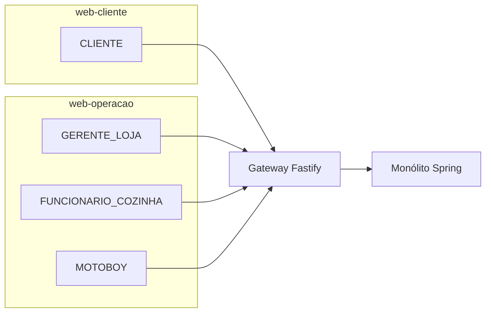
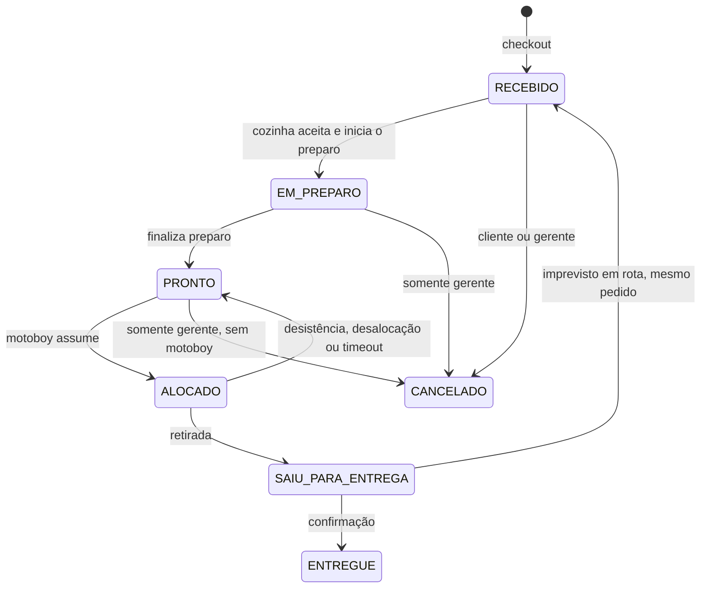
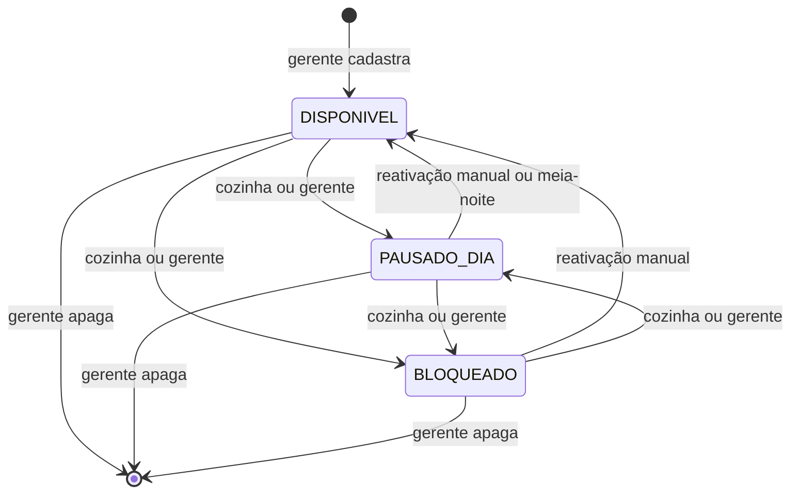
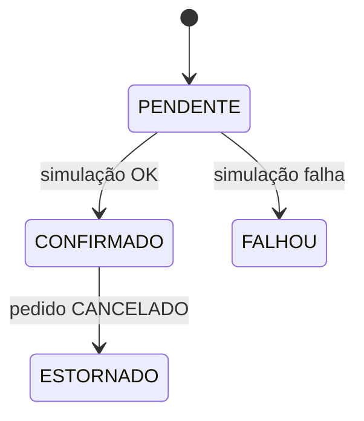
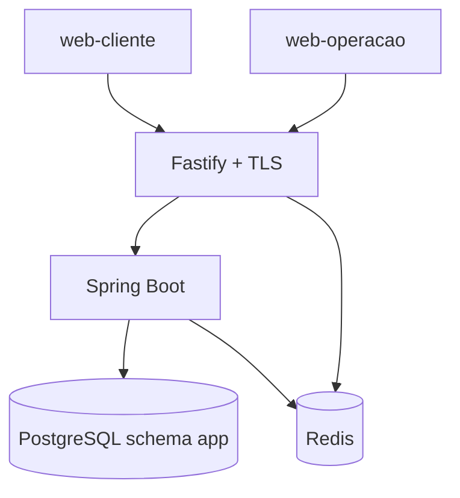

# VGO Proposta de MVP — operação transacional de delivery (loja única)

Sistema para **uma** hamburgueria vegana de delivery própria: o cliente pede, a cozinha opera o pedido, o entregador assume a corrida. O núcleo é o **ciclo de vida do pedido**, com regras de negócio, transições de estado, transações ACID e alocação exclusiva do motoboy sob concorrência.

Este documento é a definição do MVP: o que o sistema **é**. Fluxos narrativos em `foundation/fluxos/`. Decisões de banco, estados e tempo real em `foundation/docTecnica/`.

---

## 1. O que o sistema faz


| Área           | Comportamento |
| -------------- | ------------- |
| Identidade     | Cadastro, login e sessão por perfil. Gerente cadastra e desativa cozinha e motoboy |
| Cardápio       | Categorias e produtos. Item `DISPONIVEL`, `PAUSADO_DIA` ou `BLOQUEADO`. Gerente e cozinha mudam os dois primeiros. Só o gerente apaga o produto do banco |
| Pedido         | Checkout atômico, máquina de estados, cancelamento do cliente enquanto o preparo não começou |
| Pagamento      | Simulado no próprio sistema, atômico com o pedido. Estorno só quando o pedido vai para `CANCELADO` |
| Cozinha (KDS)  | Aceitar tira o pedido da fila e inicia o preparo; depois marca pronto. Pedido na fila não é recusado |
| Entrega        | Motoboy assume pedido pronto (lock), confirma retirada e entrega. Imprevisto em rota refaz o **mesmo** pedido |
| Loja           | Abre e fecha no horário semanal ou em eventos especiais programados. Fechamento de emergência com motivo e mensagem. Cliente vê visual cinza + countdown em tempo real |
| Frete          | Taxa por zona (CEP/bairro), cadastrada pelo gerente, recalculada e gravada no checkout |
| Endereço       | Todo endereço usado no checkout é salvo. Cliente escolhe, edita, apaga e define o padrão |
| Acompanhamento | Timeline do mesmo pedido, sem mapa, empurrada por WebSocket |
| Atendimento    | Fale Conosco abre o WhatsApp da loja. O sistema não guarda mensagem |
| Telemetria     | Painel do dia em tempo real (pedidos com estado colorido, não desaparecem). Telas históricas: volume, faturamento, itens, clientes, operação |
| Auditoria      | Quem, quando, estado anterior e novo em cada transição crítica |


Checkout revalida disponibilidade no commit: item que não está `DISPONIVEL` aborta a transação (HTTP 409). Nada é cobrado.

Dois motoboys não ficam com o mesmo pedido: um ganha; o outro recebe 409.

Pedido já pago entra na fila da cozinha como `RECEBIDO` e não é recusado nem cancelado por timeout. Se ninguém aceita, permanece `RECEBIDO` e o gerente vê um alerta. Aceitar é a mesma ação que iniciar o preparo: o estado seguinte é `EM_PREPARO`. Não existe estado `ACEITO`.

Não há módulo de estoque. Bebida que volta depois de um imprevisto em rota é pendência do motoboy, registrada na auditoria.

---

## 2. Perfis, aplicações e telas

Quatro papéis. Na loja única, o gerente é o administrador da operação (usuários da loja, cardápio, motoboys ativos).


| Perfil                | Papel                                                                | Aplicação                             |
| --------------------- | -------------------------------------------------------------------- | ------------------------------------- |
| `CLIENTE`             | Pede, paga (simulado), acompanha, cancela na janela                  | `web-cliente`                         |
| `GERENTE_LOJA`        | Cardápio, usuários da loja, KDS, cancelamento/desalocação de exceção | `web-operacao`                        |
| `FUNCIONARIO_COZINHA` | Aceita, prepara, marca pronto, pausa ou bloqueia item                | `web-operacao`                        |
| `MOTOBOY`             | Fila, assume, retira, entrega, encerra e inicia turno                | `web-operacao` (PWA, viewport mobile) |


| Aplicação      | Tecnologia                 | Telas                                                                                     |
| -------------- | -------------------------- | ----------------------------------------------------------------------------------------- |
| `web-cliente`  | React + TypeScript + Vite  | Login/cadastro, cardápio, carrinho, checkout, histórico, detalhe do pedido                |
| `web-operacao` | Angular + TypeScript (PWA) | Login, KDS, cardápio (gerente), usuários da loja (gerente), fila e pedido ativo (motoboy) |


React e Angular não se misturam no mesmo app. Menus e botões seguem o perfil; a API autoriza de novo no servidor.




```text
Cliente cria pedido e pagamento simulado
        → Cozinha aceita, prepara e marca pronto
        → Motoboy assume, retira e entrega
        → Cliente acompanha os estados
```

---

## 3. Autorização (RBAC + FGAC)

**RBAC** define o tipo de ação. **FGAC** decide se *este* usuário pode agir *neste* recurso *neste* estado.

Atributos do usuário: `userId`, `roles`, `lojaId` (nulo no cliente), `motoboyAtivo`.  
Atributos do pedido: `clienteId`, `lojaId`, `motoboyId`, `estado`, `cancelamentoBloqueado`.


| Ação | Perfil | Condição no recurso |
| --- | --- | --- |
| Ver cardápio | `CLIENTE` | Itens não apagados. `PAUSADO_DIA` e `BLOQUEADO` aparecem cinza e não entram no carrinho |
| Checkout | `CLIENTE` | Só itens `DISPONIVEL`; endereço do próprio usuário; loja `ABERTA` |
| Ver pedido | `CLIENTE` | Dono do pedido |
| Ver pedido | `GERENTE_LOJA`, `FUNCIONARIO_COZINHA` | Mesma loja |
| Ver pedido | `MOTOBOY` | Alocado a ele, ou pedido `PRONTO` da mesma loja (fila) |
| Aceitar (inicia o preparo) e marcar pronto | `GERENTE_LOJA`, `FUNCIONARIO_COZINHA` | Mesma loja. Aceitar só a partir de `RECEBIDO`. Sem ação de recusar |
| Pausar para o dia / bloquear / reativar item | `GERENTE_LOJA`, `FUNCIONARIO_COZINHA` | Item da loja |
| Apagar produto | `GERENTE_LOJA` | Some do banco. Linhas de pedido antigo guardam cópia do nome e do preço |
| Gerir usuários da loja, horário, zonas, fechar em emergência | `GERENTE_LOJA` | Recurso da loja |
| Alocar | `MOTOBOY` | Mesma loja, `PRONTO`, sem motoboy, motoboy ativo |
| Sair para entrega / confirmar entrega | `MOTOBOY` | Pedido alocado a ele e estado válido |
| Desistir antes de sair | `MOTOBOY` | `ALOCADO` para ele. Pedido volta a `PRONTO` com o mesmo lanche na loja |
| Reportar imprevisto em rota | `MOTOBOY` | `SAIU_PARA_ENTREGA` alocado a ele |
| Cancelar | `CLIENTE` | Dono; estado `RECEBIDO`; `cancelamentoBloqueado = false` |
| Cancelar um pedido específico | `GERENTE_LOJA` | Mesma loja; antes de `SAIU_PARA_ENTREGA`; estorna se o pagamento estiver confirmado. Não é o fechamento da loja |
| Desalocar motoboy incapacitado em rota | `GERENTE_LOJA` | `SAIU_PARA_ENTREGA`. Sem estorno. O mesmo pedido volta para a cozinha |


FGAC no domínio Spring (`PedidoPolicy`, `CatalogoPolicy`, `UsuarioPolicy`): `@PreAuthorize` no controller, checagem no serviço de aplicação, e os `_links` HATEOAS saem da **mesma** policy. O gateway autentica a sessão; não decide permissão de recurso.

---

## 4. Estados e transações

### Pedido



Não existe estado `RECUSADO`. Não existe timeout que cancele o pedido na cozinha.

Imprevisto em rota (`FLUX-SAD-18-rota-gerente`, `FLUX-SAD-19-rota-motoboy`): o pedido **não** vira um segundo pedido na conta do cliente. Volta para `RECEBIDO`, `incident_alert = true`, `cancelamentoBloqueado = true`, motoboy desvinculado. O KDS mostra os itens, sem o nome do cliente. O lanche que estava na rota é descartado. A bebida fica como pendência de devolução do motoboy. O pagamento permanece `CONFIRMADO`.

O cliente só cancela em `RECEBIDO`, enquanto o pedido ainda está na fila da cozinha. Aceitar leva direto a `EM_PREPARO` e fecha essa janela.

### Item do cardápio



| Estado | Quem muda | No dia seguinte | O que o cliente vê |
| --- | --- | --- | --- |
| `DISPONIVEL` | — | Continua | Item normal, pode pedir |
| `PAUSADO_DIA` | Cozinha ou gerente | Volta sozinho a `DISPONIVEL` | Cinza. Texto: não está sendo produzido hoje |
| `BLOQUEADO` | Cozinha ou gerente | Não muda | Cinza. Texto: indisponível no momento |
| Apagado | Só o gerente | Não existe | Some da lista e da linha do banco |

`PAUSADO_DIA` e `BLOQUEADO` continuam na lista da cozinha e na lista do gerente. O cliente não consegue colocar o item no carrinho.

A linha do pedido guarda `product_name` e `unit_price` no momento do checkout. Apagar o produto não apaga o histórico.

### Loja

`ABERTA` · `FECHADA_HORARIO` · `FECHADA_EMERGENCIA`.

Fechamento de horário é automático. Fechamento de emergência exige motivo, aparece para o cliente e não cancela pedido já criado. Cancelar um pedido específico continua sendo ação à parte do gerente.

### Pagamento (1:1 com o pedido)



Checkout feliz: `Pedido.RECEBIDO` e `Pagamento.CONFIRMADO` no mesmo `@Transactional`. Simulação falha: rollback completo. Imprevisto em rota não estorna.

**Operações atômicas:** checkout (item `DISPONIVEL` + loja `ABERTA` + taxa da zona + pedido + snapshot do item + pagamento + auditoria); alocação do motoboy; cancelamento com estorno; voltar de `SAIU_PARA_ENTREGA` para `RECEBIDO` no imprevisto; marcar pronto.

**Concorrência:** lock otimista (`version`) nos agregados; `SELECT … FOR UPDATE` na alocação; `Idempotency-Key` em checkout, alocar, cancelar e simulação de pagamento.

PostgreSQL é a única base de dados da aplicação. Redis guarda só sessão e revogação.

---

## 5. Arquitetura e infraestrutura

Monólito modular (um processo Spring) com camadas limpas por módulo. Browser fala só com o gateway (HTTPS). Módulos conversam por código, não por REST interno.



| Serviço Compose | Função |
| --------------- | ------ |
| `postgres`      | Única fonte dos dados da aplicação |
| `redis`         | Denylist, versão de sessão, logout do dispositivo e de todos os dispositivos |
| `backend`       | Um container Spring. Publica a timeline por WebSocket no processo |
| `gateway`       | Fastify, TLS, cookies, CSRF, CORS, rate limit, proxy `/api/*` e proxy do WebSocket |
| `web-cliente`   | SPA React |
| `web-operacao`  | SPA Angular |

Exposto ao usuário: HTTPS no gateway. Correlation id (`X-Correlation-Id`) do gateway até os logs do Spring.

Tempo real da timeline: WebSocket do Spring, com broker dentro do monólito. O browser conecta no gateway, que encaminha para o Spring. Redis não transporta evento de pedido. Detalhe em `foundation/docTecnica/INF-01-tempo-real.md`.

---
