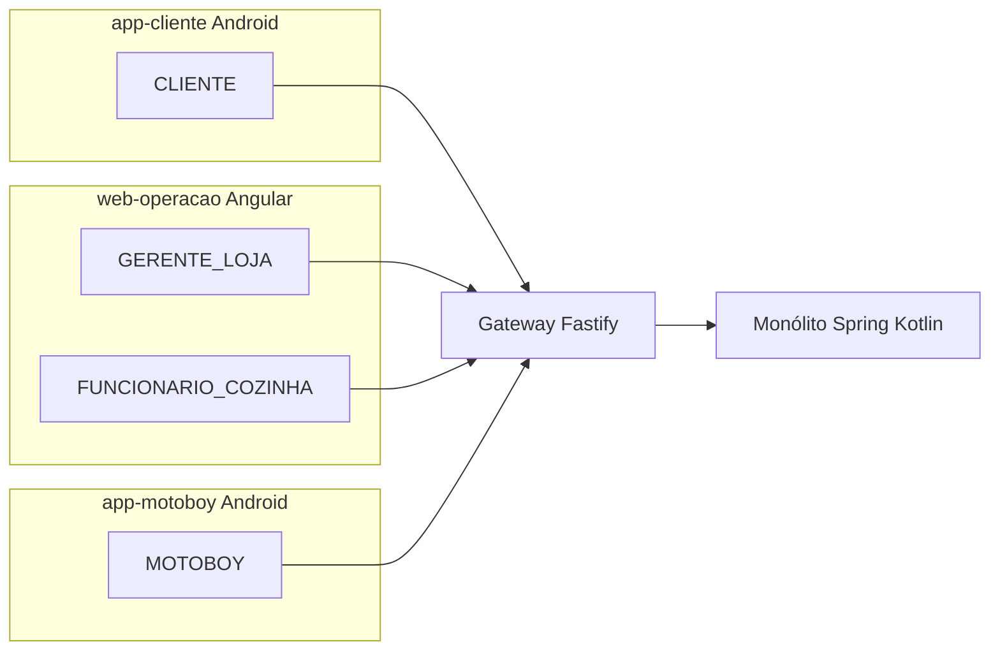
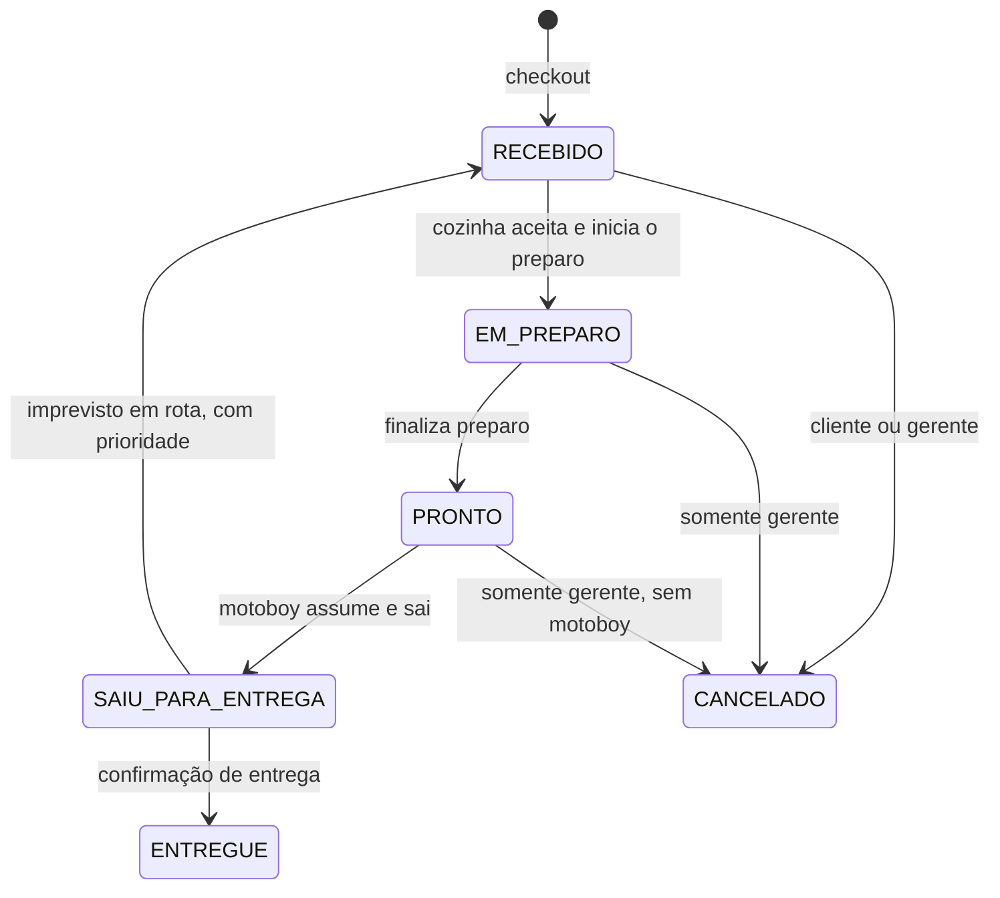
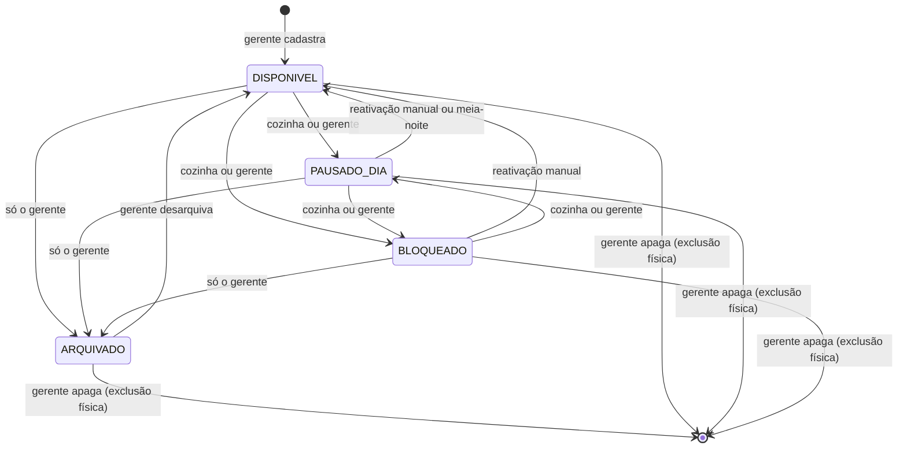
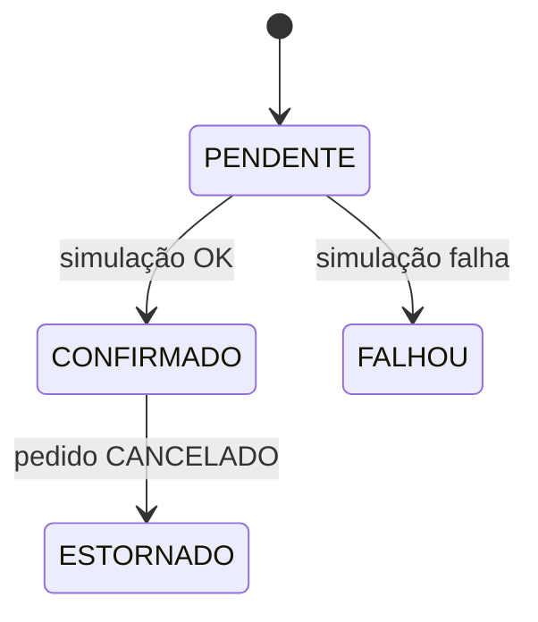
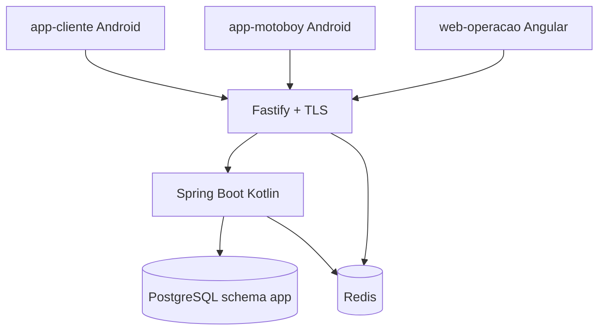

# VGO Proposta de MVP — operação transacional de delivery (loja única)

Sistema para **uma** hamburgueria vegana de delivery própria: o cliente pede, a cozinha opera o pedido, o entregador assume a corrida. O núcleo é o **ciclo de vida do pedido**, com regras de negócio, transições de estado, transações ACID e alocação exclusiva do motoboy sob concorrência.

Este documento é a definição do MVP: o que o sistema **é**. Fluxos narrativos em `foundation/fluxos/`. Decisões de banco, estados e tempo real em `foundation/docTecnica/`.

---

## 1. O que o sistema faz


| Área           | Comportamento |
| -------------- | ------------- |
| Identidade     | Cadastro, login e sessão por perfil. Gerente cadastra e desativa cozinha e motoboy |
| Cardápio       | Categorias e produtos. Item `DISPONIVEL`, `PAUSADO_DIA`, `BLOQUEADO` ou `ARQUIVADO`. Gerente e cozinha mudam `PAUSADO_DIA`/`BLOQUEADO`. Só o gerente arquiva (oculta sem apagar), desarquiva e apaga fisicamente. Cada produto tem `item_type` (`PREPARED_FOOD` ou `SEALED_BEVERAGE`) para o protocolo de imprevisto em rota |
| Pedido         | Checkout atômico, máquina de estados, cancelamento do cliente enquanto o preparo não começou |
| Pagamento      | Simulado no próprio sistema, atômico com o pedido. Estorno só quando o pedido vai para `CANCELADO` |
| Cozinha (KDS)  | Aceitar tira o pedido da fila e inicia o preparo; depois marca pronto. Pedido na fila não é recusado |
| Entrega        | Motoboy assume pedido pronto (lock) e sai em passo único. Tela de entrega exibe endereço completo + atalhos de navegação (Waze / Google Maps) e contato WhatsApp com o cliente. Imprevisto em rota refaz o **mesmo** pedido |
| Loja           | Status `ABERTA`, `FECHADA_HORARIO`, `FECHADA_PROGRAMADA` ou `FECHADA_EMERGENCIA`. Horário semanal + eventos `CLOSURE`/`OPENING` em `store_schedules`. Emergência só o gerente reabre. Cliente vê cinza + countdown quando há previsão |
| Frete          | Taxa por zona (CEP/bairro), cadastrada pelo gerente, recalculada e gravada no checkout |
| Endereço       | Todo endereço usado no checkout é salvo. Cliente escolhe, edita, apaga e define o padrão |
| Acompanhamento | Timeline do mesmo pedido, sem mapa, empurrada por WebSocket |
| Atendimento    | Gerente cadastra `whatsapp_number` da loja. Clientes e motoboys têm `phone`. Links WhatsApp montados pelo backend com contexto (número do pedido). Nenhuma mensagem é armazenada |
| Telemetria     | Painel do dia operacional (data civil no fuso da loja): pedidos ao vivo com estado colorido, sem sumir ao reabrir após pausa programada. Telas históricas: volume, faturamento, itens, clientes, operação |
| Auditoria      | Quem, quando, estado anterior e novo em cada transição crítica |


Checkout revalida disponibilidade no commit: item que não está `DISPONIVEL` aborta a transação (HTTP 409). Nada é cobrado.

Dois motoboys não ficam com o mesmo pedido: um ganha; o outro recebe 409.

Pedido já pago entra na fila da cozinha como `RECEBIDO` e não é recusado nem cancelado por timeout. Se ninguém aceita, permanece `RECEBIDO` e o gerente vê um alerta. Aceitar é a mesma ação que iniciar o preparo: o estado seguinte é `EM_PREPARO`. Não existe estado `ACEITO`.

Não há módulo de estoque. Bebida que volta depois de um imprevisto em rota é pendência do motoboy, registrada na auditoria.

---

## 2. Perfis, aplicações e telas

Quatro papéis. Na loja única, o gerente é o administrador da operação (usuários da loja, cardápio, motoboys ativos).


| Perfil                | Papel                                                                | Aplicação      |
| --------------------- | -------------------------------------------------------------------- | -------------- |
| `CLIENTE`             | Pede, paga (simulado), acompanha, cancela na janela                  | `app-cliente`  |
| `GERENTE_LOJA`        | Cardápio (incluindo arquivar), usuários da loja, KDS, cancelamento de pedido em andamento, acionamento de imprevisto em rota | `web-operacao` |
| `FUNCIONARIO_COZINHA` | Aceita, prepara, marca pronto, pausa ou bloqueia item                | `web-operacao` |
| `MOTOBOY`             | Fila, assume, sai para entrega, confirma, encerra e inicia turno     | `app-motoboy`  |


| Aplicação      | Tecnologia                 | Telas |
| -------------- | -------------------------- | ----- |
| `web-operacao` | Angular + TypeScript       | **Login** · **KDS** (cozinha e gerente) · **Cardápio** (cadastro, pausa, bloqueio, exclusão de item) · **Usuários da loja** (cozinha e motoboy) · **Horário semanal** e **eventos especiais** (`CLOSURE` / `OPENING`) · **Zonas de frete** · **WhatsApp da loja** (`whatsapp_number`) · **Painel — pedidos do dia** (lista ao vivo, filtros) · **Estatísticas / telemetria** (resumo do dia, histórico, itens, clientes, operação) · ações de exceção (cancelar pedido, imprevisto em rota) |
| `app-cliente`  | Android · Kotlin + Jetpack | **Login/cadastro** · **Cardápio** · **Carrinho** · **Checkout** (endereço, frete, pagamento simulado) · **Histórico** · **Detalhe e timeline** do pedido · **Endereços salvos** · **Fale Conosco** (WhatsApp) |
| `app-motoboy`  | Android · Kotlin + Jetpack | **Login** · **Iniciar / encerrar turno** · **Fila** de pedidos prontos · **Assumir** e **sair para entrega** · **Confirmar entrega** · pedido ativo em rota |


`web-operacao` (Angular web) é exclusivo para a operação interna da loja. Clientes e motoboys usam apps nativos Android. Menus e botões seguem o perfil; a API autoriza de novo no servidor.




```text
Cliente cria pedido e pagamento simulado
        → Cozinha aceita, prepara e marca pronto
        → Motoboy assume, retira e entrega
        → Cliente acompanha os estados
```

---

## 3. Autorização (RBAC + FGAC)

**RBAC** define o tipo de ação. **FGAC** decide se *este* usuário pode agir *neste* recurso *neste* estado.

Atributos do usuário: `userId`, `roles`, `lojaId` (nulo no cliente), `motoboyAtivo`.

> **`motoboyAtivo` no JWT** significa que o motoboy tem conta ativa **e** turno iniciado (`delivery_persons.status = DISPONIVEL` ou `EM_ENTREGA`). Conta ativa sem turno iniciado (`INATIVO`) gera `motoboyAtivo = false` — o motoboy loga, mas não vê pedidos nem pode assumir. Após um imprevisto confirmado, o motoboy envolvido retorna automaticamente a `DISPONIVEL` (turno continua ativo).  
Atributos do pedido: `clienteId`, `lojaId`, `motoboyId`, `estado`, `cancelamentoBloqueado`.


| Ação | Perfil | Condição no recurso |
| --- | --- | --- |
| Ver cardápio | `CLIENTE` | Itens não apagados. `PAUSADO_DIA` e `BLOQUEADO` aparecem cinza e não entram no carrinho |
| Checkout | `CLIENTE` | Só itens `DISPONIVEL`; endereço do próprio usuário; loja `ABERTA` |
| Ver pedido | `CLIENTE` | Dono do pedido |
| Ver pedido | `GERENTE_LOJA`, `FUNCIONARIO_COZINHA` | Mesma loja |
| Ver pedido | `MOTOBOY` | Alocado a ele, ou pedido `PRONTO` da mesma loja (fila) |
| Aceitar (inicia o preparo) e marcar pronto | `GERENTE_LOJA`, `FUNCIONARIO_COZINHA` | Mesma loja. Aceitar só a partir de `RECEBIDO`. Sem ação de recusar |
| Pausar para o dia / bloquear / reativar item | `GERENTE_LOJA`, `FUNCIONARIO_COZINHA` | Item da loja |
| Arquivar / desarquivar / apagar produto | `GERENTE_LOJA` | Arquivar: oculta de clientes e cozinha, permanece no banco. Apagar: exclusão física; linhas de pedido antigo guardam cópia do nome e do preço |
| Gerir usuários da loja, horário, zonas, fechar em emergência | `GERENTE_LOJA` | Recurso da loja |
| Assumir e sair | `MOTOBOY` | Mesma loja, `PRONTO`, sem motoboy, motoboy ativo. Transição direta para `SAIU_PARA_ENTREGA` |
| Confirmar entrega | `MOTOBOY` | `SAIU_PARA_ENTREGA` alocado a ele |
| Reportar imprevisto em rota | `MOTOBOY` | `SAIU_PARA_ENTREGA` alocado a ele |
| Cancelar | `CLIENTE` | Dono; estado `RECEBIDO`; `cancelamentoBloqueado = false` |
| Cancelar um pedido específico | `GERENTE_LOJA` | Mesma loja; `RECEBIDO`, `EM_PREPARO` ou `PRONTO` sem motoboy; estorna. Não é o fechamento da loja |
| Acionar imprevisto em rota | `GERENTE_LOJA` | `SAIU_PARA_ENTREGA`. Sem estorno. Mesmo pedido volta a `RECEBIDO` com prioridade na fila da cozinha |
| Ver links de navegação (Waze / Maps) | `MOTOBOY` | Alocado ao pedido; estado `SAIU_PARA_ENTREGA` |
| Ver telefone do cliente (link WhatsApp) | `MOTOBOY` | Alocado ao pedido; estado `SAIU_PARA_ENTREGA`. Campo `users.phone` do cliente |
| Ver telefone do motoboy (link WhatsApp) | `CLIENTE` | Dono do pedido; estado `SAIU_PARA_ENTREGA`. Campo `users.phone` do motoboy |


FGAC no domínio Spring (`PedidoPolicy`, `CatalogoPolicy`, `UsuarioPolicy`): `@PreAuthorize` no controller, checagem no serviço de aplicação, e os `_links` HATEOAS saem da **mesma** policy. O gateway autentica a sessão; não decide permissão de recurso.

---

## 4. Estados e transações

### Pedido



Não existe estado `RECUSADO`. Não existe timeout que cancele o pedido na cozinha.

Imprevisto em rota (`FLUX-SAD-18-rota-gerente`, `FLUX-SAD-19-rota-motoboy`): o pedido **não** vira um segundo pedido. Volta para `RECEBIDO` com `priority = true` — aparece no topo da fila do KDS com indicador ⚡, antes de outros `RECEBIDO`, depois de qualquer `EM_PREPARO` já em andamento. O gerente define uma mensagem para o cliente; o sistema a exibe na timeline do pedido em tempo real. O cliente vê o estado voltar a `RECEBIDO` e não pode cancelar (`cancelamentoBloqueado = true`). O KDS mostra os itens sem nome do cliente. O lanche descartado é registrado na auditoria. O pagamento permanece `CONFIRMADO`.

O cliente só cancela em `RECEBIDO`, enquanto o pedido ainda está na fila da cozinha. Aceitar leva direto a `EM_PREPARO` e fecha essa janela.

### Item do cardápio



| Estado | Quem muda | No dia seguinte | Cliente vê? | Cozinha vê? | O que o cliente vê |
| --- | --- | --- | --- | --- | --- |
| `DISPONIVEL` | — | Continua | ✅ | ✅ | Item normal, pode pedir |
| `PAUSADO_DIA` | Cozinha ou gerente | Volta sozinho a `DISPONIVEL` | ✅ | ✅ | Cinza. "Não está sendo produzido hoje." Não entra no carrinho |
| `BLOQUEADO` | Cozinha ou gerente | Não muda | ✅ | ✅ | Cinza. "Indisponível no momento." Não entra no carrinho |
| `ARQUIVADO` | **Só o gerente** | Não muda | ❌ | ❌ | Não aparece. Gerente vê em seção "Itens arquivados" |
| Apagado (física) | Só o gerente | Não existe | ❌ | ❌ | Some definitivamente do banco |

`PAUSADO_DIA` e `BLOQUEADO` continuam visíveis (cinza) no cardápio do cliente e na lista da cozinha — o cliente sabe que o produto existe mas não está disponível. `ARQUIVADO` some de todas as interfaces exceto a seção de gerenciamento do gerente — o cliente não tem ciência da existência do item. Exclusão física é permanente e não pode ser desfeita.

A linha do pedido guarda `product_name` e `unit_price` no momento do checkout. Apagar o produto não apaga o histórico.

### Loja

| Status | Origem | Cliente pode pedir? | Reabertura |
| --- | --- | --- | --- |
| `ABERTA` | Dentro do horário semanal, fim de pausa programada, ou janela `OPENING` | Sim | — |
| `FECHADA_HORARIO` | Fora do horário semanal (job ou fim de `OPENING`) | Não (cinza + countdown até `next_opens_at`) | Job no próximo horário de abertura |
| `FECHADA_PROGRAMADA` | Início de `CLOSURE` em `store_schedules` | Não (banner de pausa + countdown até `ends_at`) | Job no `ends_at` — **não** zera o painel do dia |
| `FECHADA_EMERGENCIA` | Ação manual do gerente (motivo obrigatório) | Não (motivo + mensagem opcional; countdown só se `reopen_at`) | **Só** o gerente. Nenhum job altera este status |

Jobs e eventos especiais **não** cancelam pedido já criado. Fechar a loja bloqueia carrinho e checkout novos. Cancelar um pedido específico continua sendo ação à parte do gerente.

A resolução automática de status (horário, `CLOSURE`, `OPENING`) passa por uma função única no backend: ela **ignora** loja em `FECHADA_EMERGENCIA` e, ao terminar um `CLOSURE`, recalcula o status efetivo (pode voltar a `FECHADA_HORARIO` se já passou do horário semanal). Detalhe em `foundation/docTecnica/DB-02-disponibilidade-itens.md`.

### Pagamento (1:1 com o pedido)



Checkout feliz: `Pedido.RECEBIDO` e `Pagamento.CONFIRMADO` no mesmo `@Transactional`. Simulação falha: rollback completo. Imprevisto em rota não estorna.

**Operações atômicas:** checkout (item `DISPONIVEL` + loja `ABERTA` + taxa da zona + pedido + snapshot do item + pagamento + auditoria); alocação do motoboy; cancelamento com estorno; voltar de `SAIU_PARA_ENTREGA` para `RECEBIDO` no imprevisto; marcar pronto.

**Concorrência:** lock otimista (`version`) nos agregados; `SELECT … FOR UPDATE` na alocação; `Idempotency-Key` em checkout, alocar, cancelar e simulação de pagamento.

PostgreSQL é a única base de dados da aplicação. Redis guarda só sessão e revogação.

---

## 5. Arquitetura e infraestrutura

Monólito modular (um processo Spring) com camadas limpas por módulo. Browser fala só com o gateway (HTTPS). Módulos conversam por código, não por REST interno.



| Serviço Compose | Função |
| --------------- | ------ |
| `postgres`      | Única fonte dos dados da aplicação |
| `redis`         | Denylist, versão de sessão, logout do dispositivo e de todos os dispositivos |
| `backend`       | Um container Spring Kotlin. Publica a timeline por WebSocket no processo |
| `gateway`       | Fastify, TLS, cookies (web) + Bearer header (mobile), CSRF, CORS, rate limit, proxy `/api/*` e proxy do WebSocket |
| `web-operacao`  | SPA Angular (cozinha + gerente) |

Exposto ao usuário: HTTPS no gateway. Correlation id (`X-Correlation-Id`) do gateway até os logs do Spring.

Tempo real da timeline: WebSocket do Spring, com broker dentro do monólito. O browser conecta no gateway, que encaminha para o Spring. Redis não transporta evento de pedido. Detalhe em `foundation/docTecnica/INF-01-tempo-real.md`.

---
