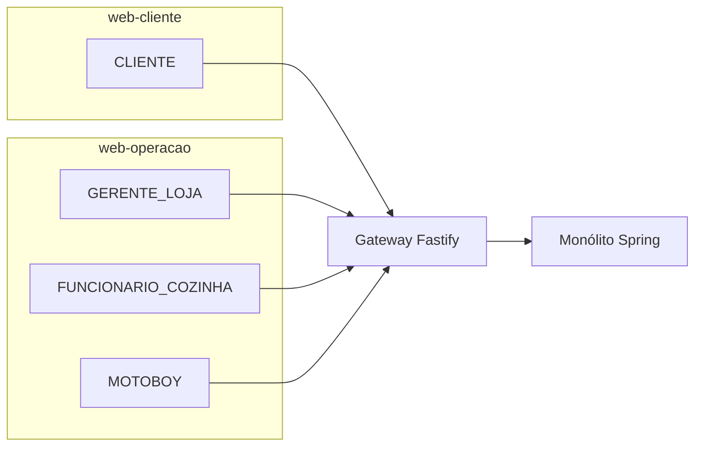
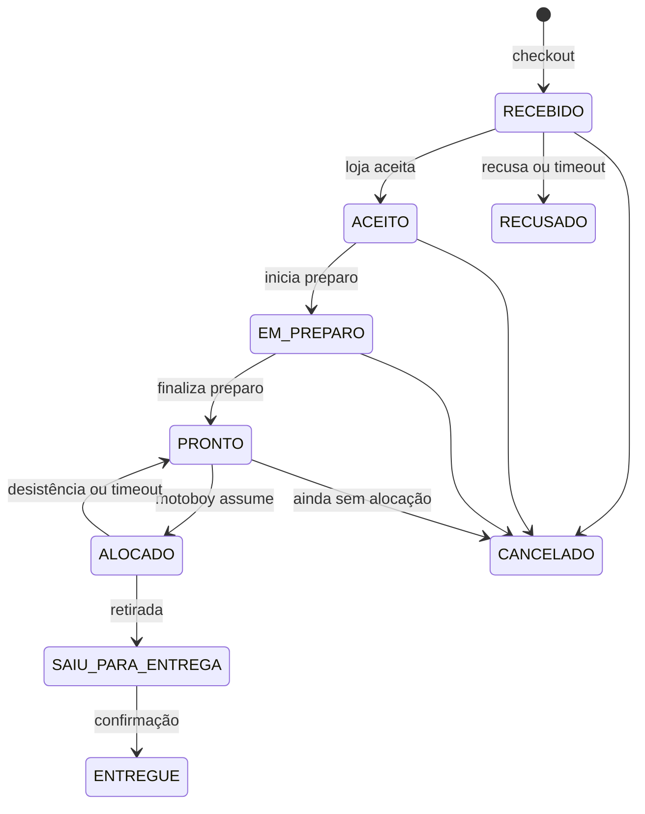
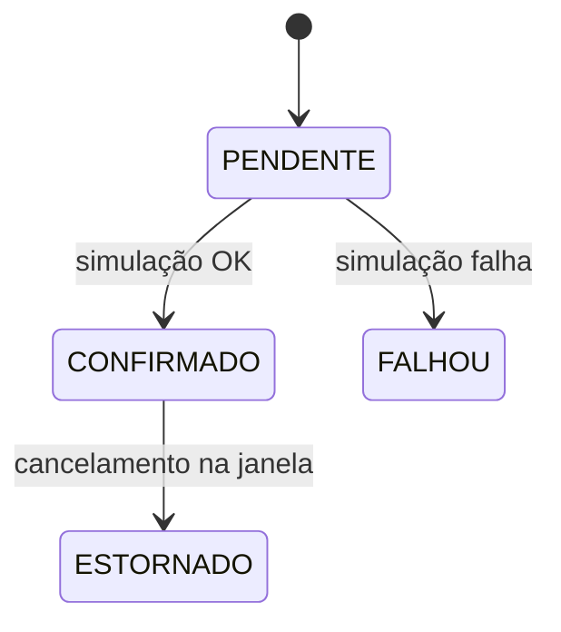
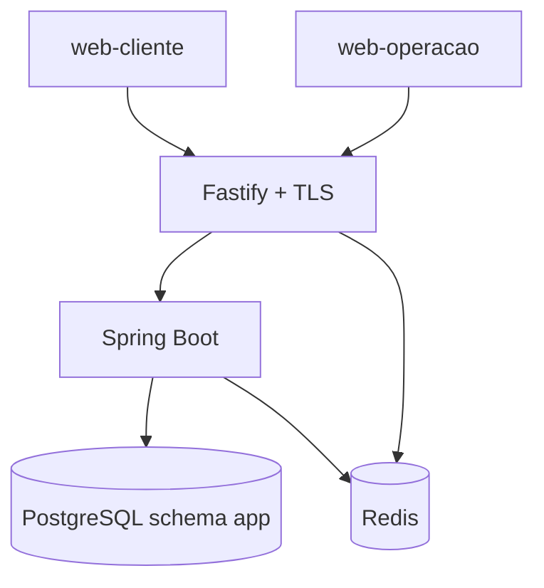

# Proposta de MVP — operação transacional de delivery (loja única)

Sistema para **uma** hamburgueria de delivery propria): o cliente pede, a cozinha opera o pedido, o entregador assume a corrida. O núcleo é o **ciclo de vida do pedido**, com regras de negócio, transições de estado, transações ACID e alocação exclusiva do motoboy sob concorrência.

Este documento é a definição do MVP: o que o sistema **é**.

---

## 1. O que o sistema faz


| Área           | Comportamento                                                              |
| -------------- | -------------------------------------------------------------------------- |
| Identidade     | Cadastro, login e sessão por perfil                                        |
| Cardápio       | Categorias e produtos da loja; gerente pausa/despausa item e crud          |
| Pedido         | Checkout atômico, máquina de estados, cancelamento com janela              |
| Pagamento      | Simulado no próprio sistema, atômico com o pedido; estorno no cancelamento |
| Cozinha (KDS)  | Aceitar/recusar, iniciar preparo, marcar pronto                            |
| Entrega        | Motoboy assume pedido pronto (lock); confirma retirada e entrega           |
| Frete          | Taxa por zona (CEP/bairro), recalculada e gravada no checkout              |
| Acompanhamento | Timeline de estados do pedido (sem mapa)                                   |
| Auditoria      | Quem, quando, estado anterior e novo em cada transição crítica             |


Checkout revalida disponibilidade no commit: item pausado depois do carrinho aborta a transação (HTTP 409).

Dois motoboys não ficam com o mesmo pedido: um ganha; o outro recebe 409.

---

## 2. Perfis, aplicações e telas

Quatro papéis. Na loja única, o gerente é o administrador da operação (usuários da loja, cardápio, motoboys ativos).


| Perfil                | Papel                                                                | Aplicação                             |
| --------------------- | -------------------------------------------------------------------- | ------------------------------------- |
| `CLIENTE`             | Pede, paga (simulado), acompanha, cancela na janela                  | `web-cliente`                         |
| `GERENTE_LOJA`        | Cardápio, usuários da loja, KDS, cancelamento/desalocação de exceção | `web-operacao`                        |
| `FUNCIONARIO_COZINHA` | Aceita, prepara, marca pronto                                        | `web-operacao`                        |
| `MOTOBOY`             | Fila, assume, retira, entrega                                        | `web-operacao` (PWA, viewport mobile) |


| Aplicação      | Tecnologia                 | Telas                                                                                     |
| -------------- | -------------------------- | ----------------------------------------------------------------------------------------- |
| `web-cliente`  | React + TypeScript + Vite  | Login/cadastro, cardápio, carrinho, checkout, histórico, detalhe do pedido                |
| `web-operacao` | Angular + TypeScript (PWA) | Login, KDS, cardápio (gerente), usuários da loja (gerente), fila e pedido ativo (motoboy) |


React e Angular não se misturam no mesmo app. Menus e botões seguem o perfil; a API autoriza de novo no servidor.




```text
Cliente cria pedido e pagamento simulado
        → Cozinha aceita, prepara e marca pronto
        → Motoboy assume, retira e entrega
        → Cliente acompanha os estados
```

---

## 3. Autorização (RBAC + FGAC)

**RBAC** define o tipo de ação. **FGAC** decide se *este* usuário pode agir *neste* recurso *neste* estado.

Atributos do usuário: `userId`, `roles`, `lojaId` (nulo no cliente), `motoboyAtivo`.  
Atributos do pedido: `clienteId`, `lojaId`, `motoboyId`, `estado`.


| Ação                                    | Perfil                                | Condição no recurso                                    |
| --------------------------------------- | ------------------------------------- | ------------------------------------------------------ |
| Ver cardápio ativo / checkout           | `CLIENTE`                             | Itens ativos; endereço do próprio usuário              |
| Ver pedido                              | `CLIENTE`                             | Dono do pedido                                         |
| Ver pedido                              | `GERENTE_LOJA`, `FUNCIONARIO_COZINHA` | Mesma loja                                             |
| Ver pedido                              | `MOTOBOY`                             | Alocado a ele, ou pedido `PRONTO` da mesma loja (fila) |
| Aceitar, recusar, preparo, pronto       | `GERENTE_LOJA`, `FUNCIONARIO_COZINHA` | Mesma loja e estado válido                             |
| Pausar produto / gerir usuários da loja | `GERENTE_LOJA`                        | Recurso da loja                                        |
| Alocar                                  | `MOTOBOY`                             | Mesma loja, `PRONTO`, sem motoboy, motoboy ativo       |
| Sair para entrega / confirmar entrega   | `MOTOBOY`                             | Pedido alocado a ele e estado válido                   |
| Cancelar                                | `CLIENTE`                             | Dono; até `ACEITO` (não após `SAIU_PARA_ENTREGA`)      |
| Cancelar / desalocar                    | `GERENTE_LOJA`                        | Mesma loja; estorno se o pagamento estiver confirmado  |


FGAC no domínio Spring (`PedidoPolicy`, `CatalogoPolicy`, `UsuarioPolicy`): `@PreAuthorize` no controller, checagem no serviço de aplicação, e os `_links` HATEOAS saem da **mesma** policy. O gateway autentica a sessão; não decide permissão de recurso.

---

## 4. Estados e transações

### Pedido




### Pagamento (1:1 com o pedido)




Checkout feliz: `Pedido.RECEBIDO` e `Pagamento.CONFIRMADO` no mesmo `@Transactional`. Simulação falha: rollback completo.

**Operações atômicas:** checkout (itens ativos + taxa da zona + pedido + pagamento + auditoria); alocação do motoboy; cancelamento com estorno; marcar pronto.

**Concorrência:** lock otimista (`version`) nos agregados; `SELECT … FOR UPDATE` na alocação; `Idempotency-Key` em checkout, alocar, cancelar e simulação de pagamento.

PostgreSQL é a fonte da verdade. Redis guarda só sessão e revogação.

---

## 5. Arquitetura e infraestrutura

Monólito modular (um processo Spring) com camadas limpas por módulo. Browser fala só com o gateway (HTTPS). Módulos conversam por código, não por REST interno.




| Serviço Compose | Função                                                                       |
| --------------- | ---------------------------------------------------------------------------- |
| `postgres`      | Dados transacionais                                                          |
| `redis`         | Denylist, versão de sessão, logout do dispositivo e de todos os dispositivos |
| `backend`       | Um container Spring                                                          |
| `gateway`       | Fastify, TLS, cookies, CSRF, CORS, rate limit, proxy `/api/*`                |
| `web-cliente`   | SPA React                                                                    |
| `web-operacao`  | SPA Angular                                                                  |


Exposto ao usuário: HTTPS no gateway. Correlation id (`X-Correlation-Id`) do gateway até os logs do Spring.

---

## 6. Gateway Fastify

Porta única (BFF): TLS, cookies `HttpOnly` + `Secure` + `SameSite` (access e refresh JWT), rotação de refresh, CSRF cookie-to-cookie, CORS das duas origens, rate limit em login e checkout, proxy para o Spring, reescrita dos `_links` para a URL pública, `X-Correlation-Id`.

Node 22, Fastify 5, `@fastify/cookie`, `@fastify/cors`, `@fastify/rate-limit`, proxy HTTP.

---

## 7. Backend — módulos e pastas

Gradle multi-módulo, Kotlin DSL, pacote `br.ufpr.tads.delivery`. Um `bootJar` em `:app`.

```text
backend/
  app/              composition root, Main, application.yml, Flyway
  shared-kernel/    ids, erros, paginação, idempotência
  identidade/
  catalogo/
  pedidos/
  pagamento/
  entrega/
  auditoria/
```

Cada módulo de domínio:

```text
domain/         entidades, estados, policies, exceções
application/    casos de uso, @Transactional, portas
api/            REST, assemblers HATEOAS, DTOs
infra/          JPA, adapters de segurança
```

`pedidos` usa portas de `catalogo` e `pagamento`; `entrega` usa porta de `pedidos`.

**Padrões:** monólito modular, hexagonal/clean, modelo de domínio com máquina de estados, policy object (FGAC), application service por caso de uso, repositório, assembler HATEOAS, BFF, idempotência, lock otimista e pessimista.

---

## 8. Dados

PostgreSQL 16, um schema `app`, 3FN. Preços e totais do pedido são snapshot no checkout. Flyway + seed (loja, um usuário por perfil, cardápio, pedidos em estados distintos para demonstração).


| Entidade                          | Papel                                             |
| --------------------------------- | ------------------------------------------------- |
| `usuario`, `role`, `usuario_role` | Identidade                                        |
| `loja`                            | Uma loja                                          |
| `endereco`, `zona_entrega`        | Entrega e taxa                                    |
| `categoria`, `produto`            | Cardápio (`disponivel`, `version`)                |
| `pedido`                          | Estado, cliente, loja, motoboy, `version`, totais |
| `item_pedido`                     | Produto, quantidade, preço unitário congelado     |
| `pagamento`                       | Estado; unique por pedido                         |
| `auditoria_evento`                | Transições                                        |
| `idempotency_key`                 | POST críticos                                     |


Constraints no banco: `CHECK` de estados, FKs, unique de pagamento. Refresh token / denylist no Redis.

---

## 9. API

REST, Richardson nível 3 (HAL). Prefixo público `https://localhost/api/`. OpenAPI gerada no Spring. Erros RFC 7807. Paginação e filtros nas listas.

Transições como sub-recursos, com rels: `self`, `aceitar`, `recusar`, `iniciar-preparo`, `marcar-pronto`, `alocar`, `sair-para-entrega`, `confirmar-entrega`, `cancelar`. A UI só oferece o que veio em `_links`.

---

## 10. Sessão e senha

```text
Browser → HTTPS Fastify (cookies + CSRF)
       → Spring valida JWT e Redis (denylist / versão)
       → RBAC → FGAC → caso de uso transacional
```

Senha: Argon2id no Spring. Access curto; refresh com rotação (reuse revoga a família). Logout invalida o `jti`; logout global incrementa `sessionVersion`.

---

## 11. Stack


| Camada   | Tecnologia                                                                                     |
| -------- | ---------------------------------------------------------------------------------------------- |
| Cliente  | React 19, Vite, TypeScript                                                                     |
| Operação | Angular 19 standalone, TypeScript, PWA                                                         |
| Gateway  | Node 22, Fastify 5, TypeScript                                                                 |
| Backend  | Kotlin, JVM 21, Spring Boot 3.4 (Web MVC, Validation, Data JPA, Security, HATEOAS, Data Redis) |
| API docs | springdoc-openapi                                                                              |
| Senha    | spring-security-crypto / BouncyCastle (Argon2id)                                               |
| Erros    | `ProblemDetail` (RFC 7807)                                                                     |
| Banco    | PostgreSQL 16, Flyway                                                                          |
| Sessão   | Redis (Lettuce)                                                                                |
| Testes   | JUnit 5, MockK, AssertJ, Testcontainers (Postgres)                                             |


---

## 12. Entrega do MVP

- Testes das transações críticas, inclusive corrida na alocação
- Docker Compose com os seis serviços da seção 5
- README de subida local
- OpenAPI + exemplos JSON (sucesso, erro, `_links`)
- Seed reproduzível para demonstração

---

*Próximo artefato de modelagem: casos de uso (principal, alternativo, exceção) de checkout, aceite da loja, alocação concorrente e cancelamento com estorno.*