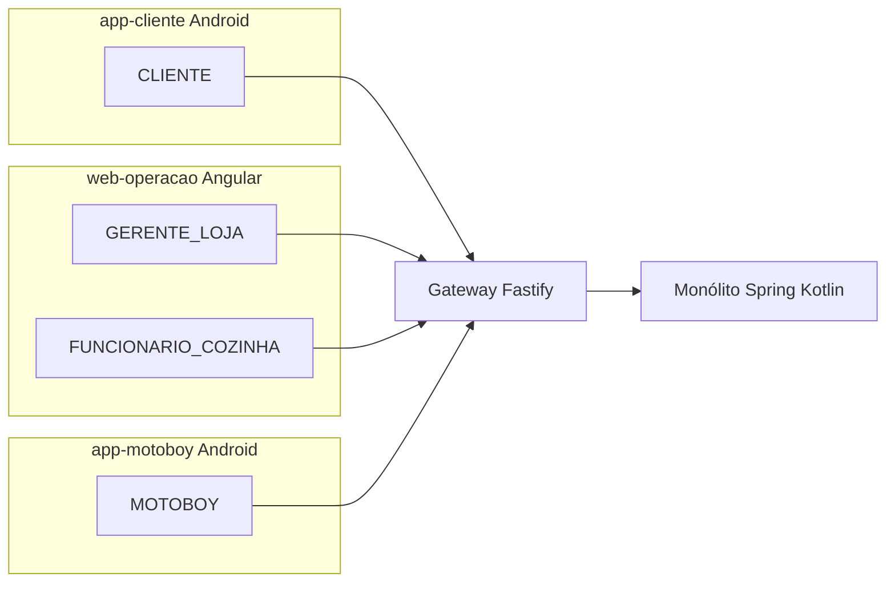
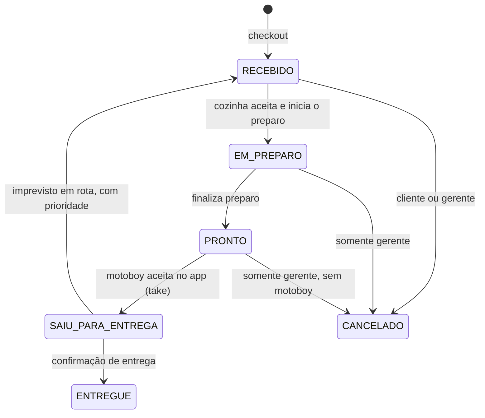
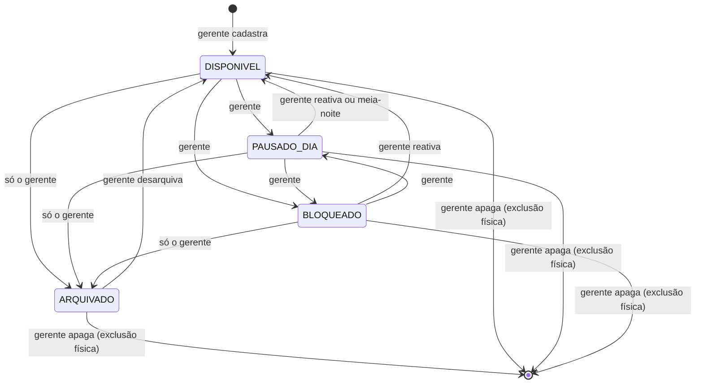
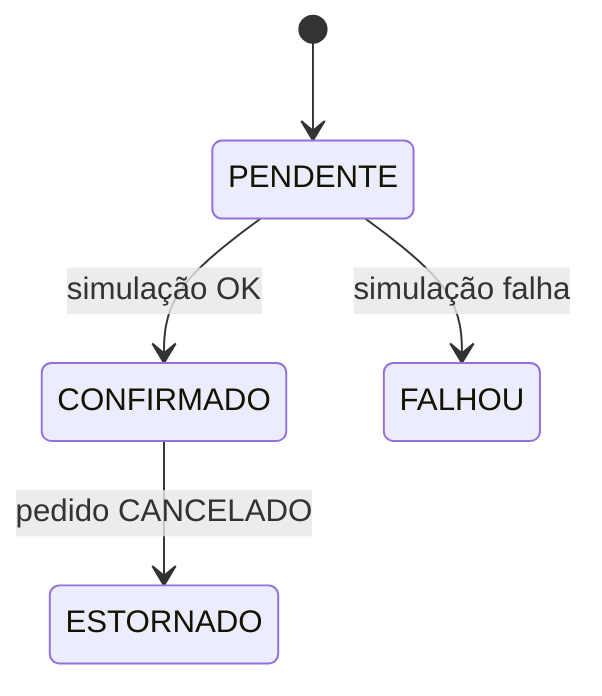
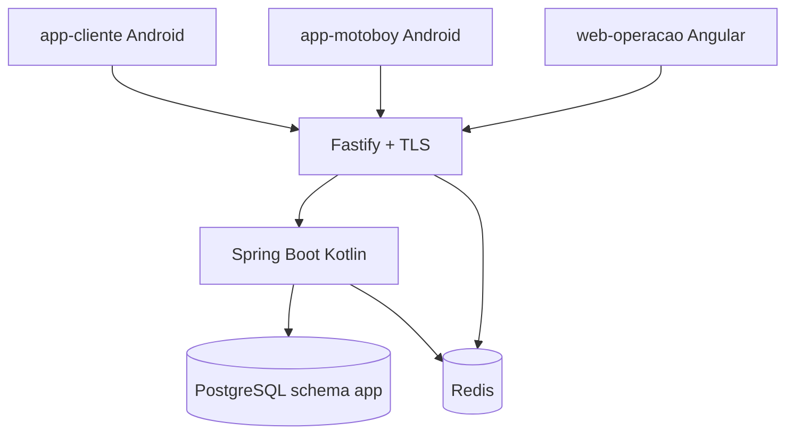

# VGO Proposta de MVP — operação transacional de delivery (loja única)

Sistema para **uma** hamburgueria vegana de delivery própria: o cliente pede, a cozinha opera o pedido, o entregador assume a corrida. O núcleo é o **ciclo de vida do pedido**, com regras de negócio, transições de estado, transações ACID e alocação exclusiva do motoboy sob concorrência.

Este documento é a definição do MVP: o que o sistema **é**. Fluxos narrativos em `foundation/fluxos/`. Decisões de banco, estados e tempo real em `foundation/docTecnica/`. **Ordem de implementação (IA):** [`IMP-01-ordem-implementacao-ai.md`](IMP-01-ordem-implementacao-ai.md).

---

## 1. O que o sistema faz

| Área           | Comportamento                                                                                                                                                                                                                                                                                                                                                                                                                |
| -------------- | ---------------------------------------------------------------------------------------------------------------------------------------------------------------------------------------------------------------------------------------------------------------------------------------------------------------------------------------------------------------------------------------------------------------------------- |
| Identidade     | **Cliente:** autocadastro no app; **recuperação de senha** por e-mail (código + nova senha 2×). **Cozinha e motoboy:** só o gerente cadastra na tela **Funcionários**; senha definida pelo funcionário na hora (gerente não vê). Reset de senha de funcionário: só gerente, com funcionário presente. Gerente desativa contas. **Cozinha:** qualquer funcionário logado abre o mesmo KDS — sem escala designada pelo gerente |
| Cardápio       | Categorias MVP ([DB-04](docTecnica/DB-04-catalogo-checkout-cliente.md)); limite diário ([DB-02](docTecnica/DB-02-disponibilidade-itens.md) § 1.2). **Só gerente** pausa/bloqueia/arquiva/apaga |
| Pedido         | Tabela **`orders`** + entidade **`Order`**: **`id` UUID** (API, timeline, imprevisto); **`display_number`** sequencial **por dia** (reset na meia-noite do fuso da loja) para cliente, KDS, embalagem e motoboy |
| Pagamento      | Simulado no próprio sistema (mock MVP), atômico com o pedido. Cliente usa forma salva (autofill) ou cadastra na hora no checkout. Estorno só quando o pedido vai para `CANCELADO`                                                                                                                                                                                                                                            |
| Cozinha (KDS)  | **Esquerda:** lista `RECEBIDO` + `EM_PREPARO` (⚡ + ordem de chegada); clique **seleciona** (não prepara sozinho). **Direita:** detalhe + **Preparar** (↖) / **Concluir preparo** (↗), timer central; vários preparos simultâneos. Ao concluir → some; anotar `display_number` na embalagem |
| Entrega        | Fila `PRONTO` no app; motoboy confere `display_number` na embalagem → **Aceitar pedido** → tela com nome, telefone, WhatsApp, Waze e Maps → **Finalizar entrega**                                                                                                                                                                                                                                                            |
| Loja           | Status `ABERTA`, `FECHADA_HORARIO`, `FECHADA_PROGRAMADA` ou `FECHADA_EMERGENCIA`. Horário semanal + eventos `CLOSURE`/`OPENING` em `store_schedules`. Emergência só o gerente reabre. Cliente vê cinza + countdown quando há previsão                                                                                                                                                                                        |
| Entrega (taxa) | **Valor fixo** por pedido: gerente define em **Configurações → Loja** (`fixed_delivery_fee_cents`). Checkout soma ao subtotal e grava snapshot em `delivery_fee_cents`. CEP/endereço **não** alteram o valor ([FLUX-HAPPY-12](fluxos/happypaths/FLUX-HAPPY-12-horario.md) · [DB-02](docTecnica/DB-02-disponibilidade-itens.md) § 2) |
| Endereço       | Cadastro no perfil (**Endereços salvos**). No checkout: combobox com endereço **padrão** pré-selecionado; cliente escolhe outro salvo ou **adiciona novo** na hora (salva no perfil). Cópia completa gravada no pedido                                                                                                                                                                                                       |
| Acompanhamento | Timeline do mesmo pedido, sem mapa, empurrada por WebSocket                                                                                                                                                                                                                                                                                                                                                                  |
| Atendimento    | Tela **nos contacte** com atalho **WhatsApp da loja** (`GET /store/contact-links`). Na **timeline** do pedido: **Fale com a loja** (sempre) e **WhatsApp do motoboy** em `SAIU_PARA_ENTREGA` (`GET /orders/{id}/contact-links`). Sem chat interno                                                                                                                                                                            |
| Telemetria     | Painel do dia (coluna **tempo preparo**, rodapé estatísticas); tela Estatísticas; rodapés no **Cardápio** e demais telas gerente ([DB-03](docTecnica/DB-03-telemetria.md) § 6 · [INF-04](docTecnica/INF-04-ui-operacao-cliente.md) § 5) |

**Fora do sistema (MVP):** não há **módulo de auditoria** (telas, relatórios ou trilha administrativa de “quem fez o quê”). **Não há cupom nem promoção** no checkout. Controles operacionais ficam em **Funcionários**, **cardápio/pedidos** (gerente), **KDS** (cozinha) e **fila/histórico** (motoboy). O cliente monta pedido pelo **cardápio + carrinho + checkout** (endereço e pagamento mock como acima).

Checkout revalida no commit: itens `DISPONIVEL`, **teto diário**, pagamento e endereço — **não** revalida se a loja ainda está `ABERTA` quando o cliente **já entrou** com sessão de compra válida (ver DB-04 § 6–7). Quem abre o app **depois** do fechamento vê loja cinza + countdown ([FLUX-SAD-14](fluxos/sadPaths/FLUX-SAD-14-loja-fechada.md)). Falha aborta a transação (HTTP 409). Nada é cobrado.

Dois motoboys não ficam com o mesmo pedido: um ganha; o outro recebe 409.

Pedido já pago entra na fila da cozinha como `RECEBIDO` e não é recusado nem cancelado por timeout. A cozinha **seleciona** um pedido na lista e clica **Preparar** para iniciar (`EM_PREPARO`); pode ter **vários** em preparo.

Não há módulo de **estoque físico**. Há **limite diário de pedidos por produto** (planejamento operacional; ver DB-02 § 1.2). Bebida que volta depois de um imprevisto em rota é pendência operacional do motoboy (gerente confirma devolução no detalhe do pedido).

---

## 2. Perfis, aplicações e telas

Quatro papéis. Na loja única, o gerente é o administrador da operação (usuários da loja, cardápio, motoboys ativos).

| Perfil                | Papel                                                                | Aplicação      |
| --------------------- | -------------------------------------------------------------------- | -------------- |
| `CLIENTE`             | Pede, paga (simulado), acompanha, cancela na janela                  | `app-cliente`  |
| `GERENTE_LOJA`        | Cardápio (incluindo arquivar), usuários da loja, KDS, cancelamento de pedido em andamento, acionamento de imprevisto em rota | `web-operacao` |
| `FUNCIONARIO_COZINHA` | KDS: aceitar da fila, preparar conferindo linhas, concluir pedido | `web-operacao` |
| `MOTOBOY`             | Fila de prontos, detalhe da entrega, histórico de corridas; turno; assume e confirma entrega | `app-motoboy`  |

| Aplicação      | Tecnologia                 | Telas |
| -------------- | -------------------------- | ----- |
| `web-operacao` | Angular + TypeScript       | **Login** · **KDS** · **Cardápio** (CRUD, limite diário, pausa, bloqueio, arquivar — **gerente**) · **Funcionários** · **Horário / Config. loja** (WhatsApp, fuso, **taxa de entrega fixa**) · **Painel do dia** · **Estatísticas** · exceções de pedido |
| `app-cliente`  | Android · Kotlin + Jetpack | Login (**sessão ~3 meses**) · cadastro · recuperar senha · cardápio (só entra se loja aberta) · carrinho (**persiste ao fechar app**, TTL **3 h**, limpa no logout) · checkout · histórico (**refazer pedido**) · **nos contacte** · timeline · endereços · pagamentos salvos |
| `app-motoboy`  | Android · Kotlin + Jetpack | **Login** · **Turno** · **Fila** (tela principal) · **Detalhe da entrega** · **Confirmar entrega** · **Histórico** de corridas aceitas |

`web-operacao` (Angular web) é exclusivo para a operação interna da loja. Clientes e motoboys usam apps nativos Android. Menus e botões seguem o perfil; a API autoriza de novo no servidor.



```text
Cliente cria pedido e pagamento simulado
        → Cozinha aceita, prepara e marca pronto
        → Motoboy assume, retira e entrega
        → Cliente acompanha os estados
```

---

## 3. Autorização (RBAC + FGAC)

**RBAC** define o tipo de ação. **FGAC** decide se *este* usuário pode agir *neste* recurso *neste* estado.

Atributos do usuário: `userId`, `roles`, `lojaId` (nulo no cliente), `motoboyAtivo`.

> `motoboyAtivo` **no JWT** significa que o motoboy tem conta ativa **e** turno iniciado (`delivery_persons.status = DISPONIVEL` ou `EM_ENTREGA`). Conta ativa sem turno iniciado (`INATIVO`) gera `motoboyAtivo = false` — o motoboy loga, mas não vê pedidos nem pode assumir. Após um imprevisto confirmado, o motoboy envolvido retorna automaticamente a `DISPONIVEL` (turno continua ativo).  
> Atributos do pedido: `clienteId`, `lojaId`, `motoboyId`, `estado`, `cancelamentoBloqueado`.

| Ação | Perfil | Condição no recurso |
| --- | --- | --- |
| Ver cardápio | `CLIENTE` | Itens não apagados/arquivados. `PAUSADO_DIA` e `BLOQUEADO` cinza. Quantidade no carrinho limitada ao **restante diário** quando houver teto |
| Checkout | `CLIENTE` | Só itens `DISPONIVEL`; endereço de entrega (salvo, outro salvo ou novo); forma de pagamento (salva ou nova); loja `ABERTA`; unidades ≤ **restante diário** por produto |
| Ver pedido | `CLIENTE` | Dono do pedido |
| Ver pedido | `GERENTE_LOJA`, `FUNCIONARIO_COZINHA` | Mesma loja |
| Ver pedido | `MOTOBOY` | Alocado a ele, ou pedido `PRONTO` da mesma loja (fila) |
| Preparar / concluir preparo | `GERENTE_LOJA`, `FUNCIONARIO_COZINHA` | Mesma loja. **Preparar** só de `RECEBIDO`; **Concluir preparo** só de `EM_PREPARO`. Qualquer pedido da lista (não só a cabeça). Sem ação de recusar |
| Pausar para o dia / bloquear / reativar item | `GERENTE_LOJA` | Item da loja. Falta de insumo (cozinha avisou): **gerente** aplica `PAUSADO_DIA` |
| Ajustar limite diário (padrão ou efetivo de hoje) | `GERENTE_LOJA` | Produto da loja |
| Arquivar / desarquivar / apagar produto | `GERENTE_LOJA` | Arquivar: oculta de clientes e cozinha, permanece no banco. Apagar: exclusão física; linhas de pedido antigo guardam cópia do nome e do preço |
| Gerir **funcionários**, horário, taxa de entrega fixa, fechar em emergência | `GERENTE_LOJA` | Recurso da loja |
| Cadastrar cozinha ou motoboy | `GERENTE_LOJA` | Sem autocadastro; senha definida pelo funcionário no fluxo presencial |
| Resetar senha de funcionário | `GERENTE_LOJA` | Cozinha ou motoboy da loja; funcionário presente digita a nova senha |
| Assumir / aceitar entrega | `MOTOBOY` | UI **Aceitar pedido** — `POST /orders/{id}/take`. Mesma loja, `PRONTO`, sem motoboy, turno ativo → `SAIU_PARA_ENTREGA` |
| Finalizar entrega | `MOTOBOY` | `SAIU_PARA_ENTREGA` alocado a ele |
| Reportar imprevisto em rota | `MOTOBOY` | `SAIU_PARA_ENTREGA` alocado a ele |
| Cancelar | `CLIENTE` | Dono; estado `RECEBIDO`; `cancelamentoBloqueado = false` |
| Cancelar um pedido específico | `GERENTE_LOJA` | Mesma loja; `RECEBIDO`, `EM_PREPARO` ou `PRONTO` sem motoboy; estorna. Não é o fechamento da loja |
| Acionar imprevisto em rota | `GERENTE_LOJA` | `SAIU_PARA_ENTREGA`. Sem estorno. Mesmo pedido volta a `RECEBIDO` com prioridade na fila da cozinha |
| Ver links de navegação (Waze / Maps) | `MOTOBOY` | Alocado ao pedido; estado `SAIU_PARA_ENTREGA` |
| Ver telefone do cliente (link WhatsApp) | `MOTOBOY` | Alocado ao pedido; estado `SAIU_PARA_ENTREGA`. Campo `users.phone` do cliente |
| Ver link WhatsApp da loja | `CLIENTE` | Tela **nos contacte** ou timeline — `GET /store/contact-links` / `contact-links.store` |
| Ver link WhatsApp do motoboy | `CLIENTE` | Dono do pedido; estado `SAIU_PARA_ENTREGA` — `contact-links.motoboy` |

FGAC no domínio Spring (`PedidoPolicy`, `CatalogoPolicy`, `UsuarioPolicy`): `@PreAuthorize` no controller, checagem no serviço de aplicação, e os `_links` HATEOAS saem da **mesma** policy. O gateway autentica a sessão; não decide permissão de recurso.

---

## 4. Estados e transações

### Pedido



Não existe estado `RECUSADO`. Não existe timeout que cancele o pedido na cozinha.

Imprevisto em rota (`FLUX-SAD-18-rota-gerente`, `FLUX-SAD-19-rota-motoboy`): motoboy **contata o gerente**; o gerente **aciona imprevisto** — o pedido **não** vira um segundo pedido. Volta para `RECEBIDO` com `priority = true` (⚡ no KDS). Mensagem ao cliente na timeline; `cancelamentoBloqueado = true`. **Descarte/devolução física dos itens não é registrada no sistema.** Pagamento permanece `CONFIRMADO`.

O cliente só cancela em `RECEBIDO`, enquanto o pedido ainda está na fila da cozinha. Aceitar leva direto a `EM_PREPARO` e fecha essa janela.

### Item do cardápio



| Estado | Quem muda | No dia seguinte | Cliente vê? | Cozinha vê? | O que o cliente vê |
| --- | --- | --- | --- | --- | --- |
| `DISPONIVEL` | — | Continua | ✅ | ✅ | Item normal, pode pedir |
| `PAUSADO_DIA` | **Gerente** | Volta sozinho a `DISPONIVEL` | ✅ | ❌ (KDS não gerencia cardápio) | Cinza. "Não está sendo produzido hoje." Não entra no carrinho |
| `BLOQUEADO` | **Gerente** | Não muda | ✅ | ❌ | Cinza. "Indisponível no momento." Não entra no carrinho |
| `ARQUIVADO` | **Só o gerente** | Não muda | ❌ | ❌ | Não aparece. Gerente vê em seção "Itens arquivados" |
| Apagado (física) | Só o gerente | Não existe | ❌ | ❌ | Some definitivamente do banco |

`PAUSADO_DIA` e `BLOQUEADO` continuam visíveis (cinza) no cardápio do cliente — o cliente sabe que o produto existe mas não está disponível. A cozinha **não** altera esses estados; só o gerente, no **Cardápio** do `web-operacao`. `ARQUIVADO` some de todas as interfaces exceto a seção de gerenciamento do gerente — o cliente não tem ciência da existência do item. Exclusão física é permanente e não pode ser desfeita.

A linha do pedido guarda `product_name` e `unit_price` no momento do checkout. Apagar o produto não apaga o histórico.

### Loja

| Status | Origem | Cliente pode pedir? | Reabertura |
| --- | --- | --- | --- |
| `ABERTA` | Dentro do horário semanal, fim de pausa programada, ou janela `OPENING` | Sim — **entrada** no cardápio / nova sessão de compra | — |
| `FECHADA_HORARIO` | Fora do horário semanal (job ou fim de `OPENING`) | Não para quem **abre o app agora** (cinza + countdown). Quem já tem sessão de compra + carrinho dentro de **3 h** ainda finaliza | Job no próximo horário de abertura |
| `FECHADA_PROGRAMADA` | Início de `CLOSURE` em `store_schedules` | Não para entrada nova (banner + countdown). Compra em andamento ≤ 3 h segue |
| `FECHADA_EMERGENCIA` | Ação manual do gerente (motivo obrigatório) | Não para entrada nova (motivo; countdown se `reopen_at`). Compra em andamento ≤ 3 h segue |

Jobs e eventos especiais **não** cancelam pedido já criado. Fechar a loja bloqueia **novos** visitantes (cardápio cinza). Cliente que **já** tinha sessão de compra iniciada com loja aberta pode terminar o checkout dentro do TTL de **3 h**. Cancelar um pedido específico continua sendo ação à parte do gerente.

A resolução automática de status (horário, `CLOSURE`, `OPENING`) passa por uma função única no backend: ela **ignora** loja em `FECHADA_EMERGENCIA` e, ao terminar um `CLOSURE`, recalcula o status efetivo (pode voltar a `FECHADA_HORARIO` se já passou do horário semanal). Detalhe em `foundation/docTecnica/DB-02-disponibilidade-itens.md`.

### Pagamento (1:1 com o pedido)



Checkout feliz: `Pedido.RECEBIDO` e `Pagamento.CONFIRMADO` no mesmo `@Transactional`. Simulação falha: rollback completo. Imprevisto em rota não estorna.

**Operações atômicas:** checkout (item `DISPONIVEL` + sessão de compra válida ou loja `ABERTA` na entrada + taxa fixa + pedido + snapshot + pagamento mock + caps); alocação do motoboy; cancelamento com estorno; imprevisto; marcar pronto.

**Concorrência:** lock otimista (`version`) nos agregados; `SELECT … FOR UPDATE` na alocação; `Idempotency-Key` em checkout, alocar, cancelar e simulação de pagamento.

PostgreSQL é a única base de dados da aplicação. Redis guarda só sessão e revogação.

---

## 5. Arquitetura e infraestrutura

Monólito modular (um processo Spring) com camadas limpas por módulo. Browser fala só com o gateway (HTTPS). Módulos conversam por código, não por REST interno.



| Serviço Compose | Função |
| --------------- | ------ |
| `postgres`      | Única fonte dos dados da aplicação |
| `redis`         | Denylist, versão de sessão, logout do dispositivo e de todos os dispositivos |
| `backend`       | Um container Spring Kotlin. Publica a timeline por WebSocket no processo |
| `gateway`       | Fastify, TLS, cookies (web) + Bearer header (mobile), CSRF, CORS, rate limit, proxy `/api/*` e proxy do WebSocket |
| `web-operacao`  | SPA Angular (cozinha + gerente) |

Exposto ao usuário: HTTPS no gateway. Correlation id (`X-Correlation-Id`) do gateway até os logs do Spring.

Tempo real da timeline: WebSocket do Spring, com broker dentro do monólito. O browser conecta no gateway, que encaminha para o Spring. Redis não transporta evento de pedido. Detalhe em `foundation/docTecnica/INF-01-tempo-real.md`.

---
